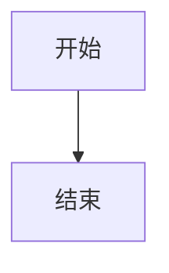

> 模板说明:由产品 agent 填写。填写正式文档时删除所有以"说明:"开头的引用行。排版见 docs/rules/format.md,规范见 docs/standards/product-standard.md。不写技术实现。背景、目标、范围、成功标准以 00 为准,本文档不重复。

## 1. 用户与场景 ★

> 说明:每个场景写清"谁、在什么情况下、要完成什么"。场景要能追溯到 00 的用户意图。

| 场景ID | 谁 | 在什么情况下 | 要完成什么 | 来源 |
|---|---|---|---|---|
| — | — | — | — | — |

## 2. 业务流程

> 说明:用 mermaid 活动图画出主流程,标出角色。异常分支单独列出。

## 3. 术语与口径补充 ★

> 说明:00 §4 已定义的不重复。只补充本文档新出现的业务名词和指标,指标必须写计算口径。全文同一个概念只用一种叫法。没有补充时写"无"。

| 术语 | 定义 | 计算口径或取值范围 | 来源 |
|---|---|---|---|
| — | — | — | — |

## 4. 业务规则与状态流转 ★

> 说明:规则要具体到可判断。涉及计算的规则必须给一组算例。状态要列全,每个状态变化写清谁触发、什么条件。

| 规则ID | 规则 | 算例或示例 | 来源 |
|---|---|---|---|
| BR-001 | — | — | — |

### 状态表

| 状态 | 进入条件 | 触发角色 | 可流转到 |
|---|---|---|---|
| — | — | — | — |

## 5. 功能需求 ★

### 5.1 需求列表

> 说明:一条需求只说一件事,描述用"[角色]能够[做什么]"。来源指向 00 的条目或 01a 的结论。状态填"待确认"或"已确认"。

| ID | 名称 | 描述 | 优先级 | 来源 | 关联 | 状态 |
|---|---|---|---|---|---|---|
| FR-001 | — | — | 必须 | — | — | 待确认 |

### 5.2 需求详述

> 说明:每条优先级为"必须"和"应该"的需求填一份,小标题照抄,不适用的写"无"。原型上的元素标序号,功能说明按序号逐个解释,两者一一对应。验收标准写成"前置条件 / 操作 / 预期结果",预期结果要可判定;一条需求可以有多组,编号为 FR-001-AC1、FR-001-AC2。

#### FR-001 [名称]

- **原型**:docs/prototypes/ 下的文件名。原型里每个可操作或会变化的元素标 ①②③。
- **功能说明**:

| 序号 | 元素 | 说明(显示什么、怎么操作、有什么限制) |
|---|---|---|
| ① | — | — |

- **流程**:该功能内部的步骤或判断较多时,用 mermaid 画出;简单的写"无"。
- **输入**:用户提供或系统读取的数据,引用 §9 的字段。
- **处理规则**:引用 BR 编号。
- **输出**:用户看到或系统产生的结果。
- **示例**:至少一组具体的输入和对应的输出。

| 验收ID | 前置条件 | 操作 | 预期结果 |
|---|---|---|---|
| FR-001-AC1 | — | — | — |

| 本功能特有的异常 | 系统应该怎么处理 |
|---|---|
| — | — |

## 6. 全局说明 ★

> 说明:所有功能共用的规则写在这里,各功能直接引用,不重复写。

### 6.1 权限矩阵

> 说明:角色对操作,每格写"允许"或"禁止",不留空。角色列按实际角色增减(列名照抄的例外)。

| 操作 \ 角色 | 角色A | 角色B |
|---|---|---|
| — | — | — |

### 6.2 通用异常处理

> 说明:各功能都会遇到的情况,如网络失败、数据为空、登录过期、无权限。

| 异常情况 | 统一的处理方式 |
|---|---|
| — | — |

### 6.3 字段规则

> 说明:多个功能共用的输入和显示规则,如金额保留几位小数、日期格式、百分比怎么显示、长度限制。

| 字段类型 | 规则 | 示例 |
|---|---|---|
| — | — | — |

## 7. 非功能需求

> 说明:按类别(性能、安全、可用性、兼容性、监控、合规等)写,每条有指标和验证方法。不适用的类别不必列出。

| ID | 类别 | 指标 | 验证方法 | 优先级 | 来源 |
|---|---|---|---|---|---|
| NFR-001 | — | — | — | 必须 | — |

## 8. 页面清单与原型 ★

> 说明:只表达内容与交互,不规定颜色、字体、像素。每页必须写四种状态。详细线框放 docs/prototypes/。

| 页面 | 目的 | 入口 | 对应需求 | 空 | 加载中 | 出错 | 无权限 | 操作后跳转 |
|---|---|---|---|---|---|---|---|---|
| — | — | — | — | — | — | — | — | — |

## 9. 数据需求 ★

> 说明:只写需要什么字段、含义、是否必填、从哪来、多久更新。不写类型和表结构,那是技术方案的事。

| 字段 | 含义 | 必填 | 来源系统或提供人 | 更新频率 | 说明 |
|---|---|---|---|---|---|
| — | — | — | — | — | — |

## 10. 范围核对表 ★

> 说明:逐条对照 00 的"做/不做/暂不做",证明没有遗漏也没有越界。

| 00 的条目 | 覆盖它的 FR | 备注 |
|---|---|---|
| — | — | — |

- [ ] 00 的每个"做"都被至少一条 FR 覆盖
- [ ] 没有出现 00 的"不做"

## 11. 给开发与测试的约束 ★

> 说明:固定内容,填写时保留,只按项目情况增删。

- 只实现 §5.1 中状态为"已确认"的需求。未列出的功能和 00 的"不做"一律不实现。
- 遇到"待确认"、矛盾或缺失,停下并登记到 docs/issues.md,不自行决定。
- 不得新增本文档没有的字段、指标或业务规则。
- 术语和指标口径以 00 §4 和本文档 §3 为准。
- 每条验收标准(FR-xxx-ACn)至少对应一条测试用例。

## 12. 可行性评审记录 ★

> 说明:产品 agent 不填,留给负责人在开发评审后填写。

| 需求ID | 开发意见 | 结论 | 日期 |
|---|---|---|---|
| — | — | — | — |

## G1 检查

> 说明:由负责人确认。全部勾选后,才能把状态改为"已冻结"。

- [ ] 每条 FR 有来源;每条"必须"需求有验收标准,且至少覆盖一个异常情况
- [ ] 无技术实现描述
- [ ] 可行性评审已完成
- [ ] 无阻塞问题

## 自检清单

- [ ] 章节与表头与模板一致,说明行已删除
- [ ] 无"等、相关、适当、快速"这类无法验证的词
- [ ] 每条验收标准是"前置条件 / 操作 / 预期结果"三段式,并有验收ID
- [ ] 原型上的序号和功能说明一一对应
- [ ] 同一术语全文只有一种叫法
- [ ] 编号连续,引用正确
- [ ] 阻塞问题已写入 docs/issues.md
