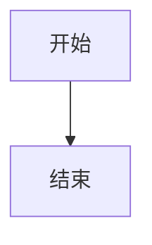

> 模板说明:由产品 agent 填写。填写正式文档时删除所有以"说明:"开头的引用行。排版见 docs/rules/format.md,规范见 docs/standards/product-standard.md。不写技术实现。

## 1. 用户与场景 ★

> 说明:每个场景写清"谁、在什么情况下、要完成什么"。场景要能追溯到 00 的用户意图。

| 场景ID | 谁 | 在什么情况下 | 要完成什么 | 来源 |
|---|---|---|---|---|
| — | — | — | — | — |

## 2. 业务流程

> 说明:用 mermaid 活动图画出主流程,标出角色。异常分支单独列出。

## 3. 业务规则与状态流转 ★

> 说明:规则要具体到可判断,状态要列全。每个状态变化写清谁触发、什么条件。

| 规则ID | 规则 | 来源 |
|---|---|---|
| BR-001 | — | — |

### 状态表

| 状态 | 进入条件 | 触发角色 | 可流转到 |
|---|---|---|---|
| — | — | — | — |

## 4. 功能需求表 ★

> 说明:一条需求只说一件事。验收标准必须写成"前置条件 / 操作 / 预期结果"三段,预期结果要可判定。来源指向 00 的条目或 01a 的结论。

| ID | 描述 | 优先级 | 验收标准(前置条件/操作/预期结果) | 来源 | 关联 |
|---|---|---|---|---|---|
| FR-001 | — | 必须 | — | — | — |

## 5. 非功能需求

> 说明:按类别(性能、安全、可用性、合规等)写,每条有指标和验证方法。

| ID | 类别 | 指标 | 验证方法 | 优先级 | 来源 |
|---|---|---|---|---|---|
| NFR-001 | — | — | — | 必须 | — |

## 6. 权限矩阵 ★

> 说明:角色对操作,每格写"允许"或"禁止",不留空。角色列按实际角色增减(列名照抄的例外)。

| 操作 \ 角色 | 角色A | 角色B |
|---|---|---|
| — | — | — |

## 7. 页面清单与原型 ★

> 说明:只表达内容与交互,不规定颜色、字体、像素。每页必须写四种状态。详细线框放 docs/prototypes/。

| 页面 | 目的 | 入口 | 元素 | 空 | 加载中 | 出错 | 无权限 | 操作后跳转 |
|---|---|---|---|---|---|---|---|---|
| — | — | — | — | — | — | — | — | — |

## 8. 数据需求 ★

> 说明:只写需要什么字段、含义、是否必填、从哪来。不写类型和表结构,那是技术方案的事。

| 字段 | 含义 | 必填 | 来源 | 说明 |
|---|---|---|---|---|
| — | — | — | — | — |

## 9. 范围核对表 ★

> 说明:逐条对照 00 的"做/不做/暂不做",证明没有遗漏也没有越界。

| 00 的条目 | 覆盖它的 FR | 备注 |
|---|---|---|
| — | — | — |

- [ ] 00 的每个"做"都被至少一条 FR 覆盖
- [ ] 没有出现 00 的"不做"

## 10. 可行性评审记录 ★

> 说明:产品 agent 不填,留给负责人在开发评审后填写。

| 需求ID | 开发意见 | 结论 | 日期 |
|---|---|---|---|
| — | — | — | — |

## G1 检查

> 说明:由负责人确认。全部勾选后,才能把状态改为"已冻结"。

- [ ] 每条 FR 有来源和验收标准
- [ ] 无技术实现描述
- [ ] 可行性评审已完成
- [ ] 无阻塞问题

## 自检清单

- [ ] 章节与表头与模板一致,说明行已删除
- [ ] 无"等、相关、适当、快速"这类无法验证的词
- [ ] 每条 FR 的验收标准是三段式
- [ ] 编号连续,引用正确
- [ ] 阻塞问题已写入 docs/issues.md
