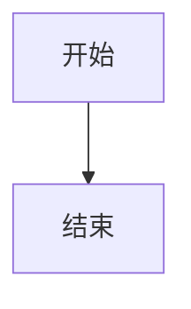

# 产品文档模板

> 使用说明:每节标题下以"说明:"开头的行是填写提示,正式填写时删除。标 ★ 的章节是精简版也必须保留的章节。空着的单元格写"—",不知道的写"待确认"。版本号:冻结前 v0.1、v0.2……,每次修改加 0.1;第一次冻结改为 v1.0;冻结后措辞类小修订加 0.1,增删改需求、范围、验收标准等实质变更加 1.0。每次改版本号都在修订记录里加一行。文中的"00"指立项时的《初步分析》文档。本文档按"目的、竞品分析、范围、需求、页面"的顺序写,前一部分是后一部分的依据。

> 模板说明:填写正式文档时删除所有以"说明:"开头的引用行。不写技术实现。本文档的逻辑链是:目的(§1)→ 竞品维度与结论(§2)→ 范围(§3)→ 需求(§8)→ 页面(§9)。每一环用编号指向上一环:G(目标)→ CP(竞品结论)→ SP(范围)→ FR(需求)。

## 文档信息与修订记录

> 说明:版本号规则见文首的使用说明。填写人是写这份文档的人,审核人是评审的人,确认人是冻结文档的负责人。

| 项目名称 | 文档编号 | 当前版本 | 状态 | 填写人 | 审核人 | 确认人 | 确认日期 |
|---|---|---|---|---|---|---|---|
| — | PRD-YYYY-NNN | v0.1 | 草稿 | — | — | — | — |

| 版本 | 日期 | 修改人 | 对应变更或问题(CHG/Q 编号) | 修改内容与原因 | 确认人 |
|---|---|---|---|---|---|
| v0.1 | — | — | — | 初稿 | — |

## 1. 目的 ★

> 说明:承接 00 的背景与目标,写成可核对的形式。只写要解决的问题,不写方案。每个目标要有衡量指标,拿不到当前值的写"未知"。与 00 不一致的地方写入 问题清单 说明原因。

- 要解决的问题:—
- 为什么现在做:—
- 现状(现在是怎么做的):—

| 目标ID | 目标 | 衡量指标 | 当前值 | 目标值 | 来源 |
|---|---|---|---|---|---|
| G-001 | — | — | — | — | — |

## 2. 竞品分析 ★

### 2.1 范围与维度

> 说明:先定范围,再定维度,不要边看边加维度。范围包括直接竞品、开源方案、替代方案(含 Excel、人工流程)。每个维度必须对应一个目标 G-xxx,没有对应目标的维度不分析。

- 直接竞品:—
- 开源方案:—
- 替代方案:—

| 维度 | 对应目标 | 为什么要看这个 |
|---|---|---|
| — | G-001 | — |

### 2.2 证据等级

> 说明:所有判断都要标证据等级,价格与功能判断还要标日期和来源。拿不到证据写"未核实"。

| 等级 | 含义 |
|---|---|
| A | 官方文档或亲自实测 |
| B | 官方宣传页、可信媒体 |
| C | 搜索摘要、二手转述 |
| D | 传闻、无来源 |

### 2.3 对比矩阵

> 说明:每格格式为"结论 [等级 | 来源 | 日期]"。

| 维度 | 我们的目标 | 竞品 A | 竞品 B | 开源 C | 替代方案 |
|---|---|---|---|---|---|
| — | — | — | — | — | — |

### 2.4 结论

> 说明:每条结论带编号,指向矩阵里的证据。必须回答三个问题:我们的差异化是什么、自研购买还是借鉴、哪些做法可以复用。C、D 级证据不得作为取舍功能的唯一依据。

| 结论ID | 结论 | 回答的问题 | 证据等级 |
|---|---|---|---|
| CP-001 | — | — | — |

### 2.5 缺口与待核实

> 说明:没查到、没核实的内容列在这里,不要在正文里写成事实。

- —

## 3. 范围 ★

> 说明:"做"的依据是目标或竞品结论;"不做"写理由;"未来可做"写触发条件。没列入"做"的一律视为不做。00 的"不做"不得出现在"做"里。

| 范围ID | 内容 | 类别(做/不做/未来可做) | 依据(G-xxx 或 CP-xxx) | 备注或触发条件 |
|---|---|---|---|---|
| SP-001 | — | 做 | — | — |

## 4. 术语定义 ★

> 说明:本文档用到的每个业务名词和指标只用一种叫法。指标必须写计算口径。00 §4 已定义的可直接引用,不必重复。

| 术语 | 定义 | 计算口径或取值范围 | 来源 |
|---|---|---|---|
| — | — | — | — |

## 5. 用户与场景 ★

> 说明:每个场景写清"谁、在什么情况下、要完成什么"。场景要能追溯到 00 的用户意图。

| 场景ID | 谁 | 在什么情况下 | 要完成什么 | 来源 |
|---|---|---|---|---|
| SC-001 | — | — | — | — |

## 6. 业务流程(用户活动图)

> 说明:每个主要场景一张 mermaid 活动图,标出角色。异常分支单独列出。

## 7. 业务规则与状态流转 ★

> 说明:规则要具体到可判断。涉及计算的规则必须给一组算例。状态要列全,每个状态变化写清谁触发、什么条件。

| 规则ID | 规则 | 算例或示例 | 来源 |
|---|---|---|---|
| BR-001 | — | — | — |

### 状态表

| 状态 | 进入条件 | 触发角色 | 可流转到 |
|---|---|---|---|
| — | — | — | — |

## 8. 需求表 ★

### 8.1 需求列表

> 说明:一条需求只说一件事,描述用"[角色]能够[做什么]"。来源指向范围条目 SP-xxx。状态填"待确认"或"已确认"。

| ID | 名称 | 描述 | 优先级 | 来源(SP) | 关联 | 状态 |
|---|---|---|---|---|---|---|
| FR-001 | — | — | 必须 | — | — | 待确认 |

### 8.2 需求详述

> 说明:每条优先级为"必须"和"应该"的需求填一份,小标题照抄,不适用的写"无"。原型上的元素标序号,功能说明按序号逐个解释,两者一一对应。验收标准写成"前置条件 / 操作 / 预期结果",预期结果要可判定;一条需求可以有多组,编号为 FR-001-AC1、FR-001-AC2。

#### FR-001 [名称]

- **原型**:原型附件 下的文件名。原型里每个可操作或会变化的元素标 ①②③。
- **功能说明**:

| 序号 | 元素 | 说明(显示什么、怎么操作、有什么限制) |
|---|---|---|
| ① | — | — |

- **流程**:该功能内部的步骤或判断较多时,用 mermaid 画出;简单的写"无"。
- **输入**:用户提供或系统读取的数据,引用 §12 的字段。
- **处理规则**:引用 BR 编号。
- **输出**:用户看到或系统产生的结果。
- **示例**:至少一组具体的输入和对应的输出。

| 验收ID | 前置条件 | 操作 | 预期结果 |
|---|---|---|---|
| FR-001-AC1 | — | — | — |

- **验收口径**:写清谁来判定、拿什么数据或标准判定、通过的阈值或允许的误差。结果无法精确比对的需求(如归因结论、文本摘要、推荐)必须写判定规则。

| 验收ID | 判定人 | 判定依据(数据或标准) | 通过阈值或允许误差 |
|---|---|---|---|
| FR-001-AC1 | — | — | — |

- **正例与反例**:给出具体样例,说明合格和不合格的区别。反例要写明"为什么不合格"。数量以能说清边界为准,通常每类 1 到 3 个。

| 类型(正例/反例) | 样例(输入与输出) | 判定及理由 | 来源 |
|---|---|---|---|
| 正例 | — | — | — |
| 反例 | — | — | — |

| 本功能特有的异常 | 系统应该怎么处理 |
|---|---|
| — | — |

## 9. 页面清单与原型 ★

> 说明:只表达内容与交互,不规定颜色、字体、像素。每页必须写四种状态。详细线框放 原型附件。

| 页面 | 目的 | 入口 | 对应需求 | 空 | 加载中 | 出错 | 无权限 | 操作后跳转 |
|---|---|---|---|---|---|---|---|---|
| — | — | — | — | — | — | — | — | — |

## 10. 全局说明 ★

> 说明:所有功能共用的规则写在这里,各功能直接引用,不重复写。

### 10.1 权限矩阵

> 说明:角色对操作,每格写"允许"或"禁止",不留空。角色列按实际角色增减(列名照抄的例外)。

| 操作 \ 角色 | 角色A | 角色B |
|---|---|---|
| — | — | — |

### 10.2 通用异常处理

> 说明:各功能都会遇到的情况,如网络失败、数据为空、登录过期、无权限。

| 异常情况 | 统一的处理方式 |
|---|---|
| — | — |

### 10.3 字段规则

> 说明:多个功能共用的输入和显示规则,如金额保留几位小数、日期格式、百分比怎么显示、长度限制。

| 字段类型 | 规则 | 示例 |
|---|---|---|
| — | — | — |

## 11. 非功能需求

> 说明:按类别(性能、安全、可用性、兼容性、监控、合规等)写,每条有指标和验证方法。不适用的类别不必列出。

| ID | 类别 | 指标 | 验证方法 | 优先级 | 来源 |
|---|---|---|---|---|---|
| NFR-001 | — | — | — | 必须 | — |

## 12. 数据需求 ★

> 说明:只写需要什么字段、含义、是否必填、从哪来、多久更新。不写类型和表结构,那是技术方案的事。

| 字段 | 含义 | 必填 | 来源系统或提供人 | 更新频率 | 说明 |
|---|---|---|---|---|---|
| — | — | — | — | — | — |

## 13. 目的与范围核对 ★

> 说明:两个方向都要核对。目标没有需求覆盖,说明做不到目的;需求追不到范围,说明越界了。

| 目标ID | 覆盖它的 FR | 是否足以达成 |
|---|---|---|
| G-001 | — | — |

| 范围ID(类别为"做") | 覆盖它的 FR | 备注 |
|---|---|---|
| SP-001 | — | — |

- [ ] 每个目标至少有一条 FR
- [ ] 每个"做"至少有一条 FR
- [ ] 每条 FR 的来源能追到某个 SP,没有出现"不做"和 00 的"不做"

## 14. 给开发与测试的约束 ★

> 说明:固定内容,填写时保留,只按项目情况增删。

- 只实现 §8.1 中状态为"已确认"的需求。未列出的功能和"不做"一律不实现。
- 竞品分析(§2)是决策依据,不是需求,不得因为竞品有某功能就实现它。
- 遇到"待确认"、矛盾或缺失,停下并登记到 问题清单,不自行决定。
- 不得新增本文档没有的字段、指标或业务规则。
- 术语和指标口径以 00 §4 和本文档 §4 为准。
- 每条验收标准(FR-xxx-ACn)至少对应一条测试用例。

## 15. 可行性评审记录 ★

> 说明:留给负责人在开发评审后填写。

| 需求ID | 开发意见 | 结论 | 日期 |
|---|---|---|---|
| — | — | — | — |

## G1 检查

> 说明:由负责人确认。全部勾选后,才能把状态改为"已冻结"。

- [ ] 每个竞品维度对应一个目标;每条竞品结论有证据等级
- [ ] 每个目标有需求覆盖,每条 FR 能追到范围
- [ ] 验收口径已写清判定人、判定依据和阈值
- [ ] 每条 FR 有来源;每条"必须"需求有验收标准,且至少覆盖一个异常情况
- [ ] 无技术实现描述
- [ ] 可行性评审已完成
- [ ] 无阻塞问题

## 自检清单

- [ ] 章节与表头与模板一致,说明行已删除
- [ ] 竞品判断都有证据等级、来源和日期,三个结论问题都已回答
- [ ] 没有编造竞品的功能、价格、用户数
- [ ] 无"等、相关、适当、快速"这类无法验证的词
- [ ] 每条验收标准是"前置条件 / 操作 / 预期结果"三段式,并有验收ID
- [ ] 结果无法精确比对的需求有验收口径,并有至少一个正例和一个反例
- [ ] 原型上的序号和功能说明一一对应
- [ ] 同一术语全文只有一种叫法
- [ ] 编号连续,引用正确
- [ ] 阻塞问题已写入 问题清单
